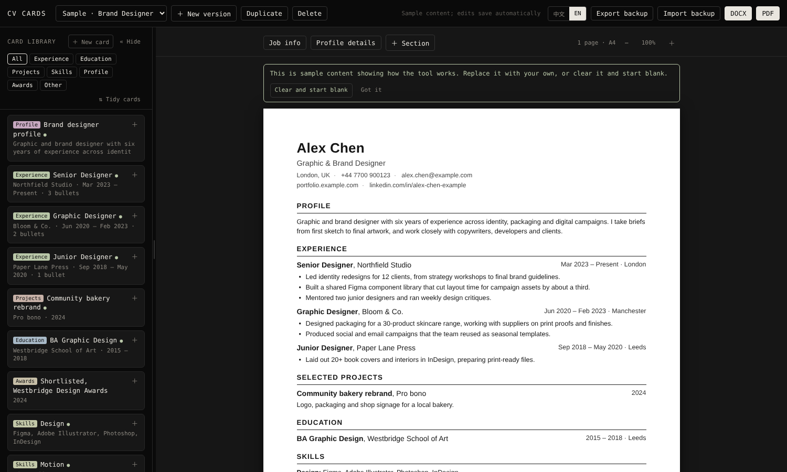

# CV Cards

**English** · [繁體中文](#繁體中文)

Build a tailored CV for every job from one library of reusable cards. Write your experience, education, skills and projects once, then drag the cards you need onto an A4 page, reword bullets for a specific role, and export a PDF or Word file.

## Features

- **Card library.** Each job, degree, project, award or skill group is a card. Edit a card once and every CV version updates.
- **One version per job.** Duplicate a version, then switch bullets on or off, reorder them, or reword them for that role only. The original card stays unchanged.
- **Edit on the page.** The A4 page is the editor. Drag sections, entries and bullets, click any text to change it, and see page breaks as you go.
- **PDF and DOCX export.** English PDFs keep the exact line and page breaks you see, with real selectable text that ATS software can read. DOCX files open in Word and Google Docs.
- **Undo and redo.** Deleted something by mistake? Press ↶ at the top or Ctrl+Z (⌘Z on Mac), and ↷ or Ctrl+Shift+Z to redo.
- **First-run tour.** A short guided tour shows the main parts on first visit. Press **?** at the top to see it again.
- **Chinese or English interface.** Switch at the top right; your choice is remembered.
- **Private by design.** Everything is saved in your own browser. Nothing is sent to a server.

## Use it

**Online:** open the GitHub Pages link for this repository (see "Publish your own copy" below).

**On your computer:** download `index.html` and open it in Chrome, Edge, Safari or Firefox. An internet connection is needed the first time so the page can load its fonts and libraries.

The first time you open it you'll see a fictional sample CV (Alex Chen, a brand designer). Replace it with your own content, or press **Clear and start blank**.

## Your data

- Your cards and versions are stored in your browser's local storage, on your computer only.
- Clearing browser data, or switching browser or computer, means starting again. Use **Export backup** to save a `.json` file, and **Import backup** to restore it anywhere.
- Nobody else, including whoever hosts the page, can see what you write.

## Notes on export

- **PDF with Chinese text** is exported as images so it matches the page exactly; ATS software can't read the text in that case. For ATS-screened jobs, export DOCX and save it as PDF from Word.
- **DOCX** uses Arial for Latin text and Microsoft JhengHei for Chinese. Mac Preview and TextEdit show Word files in a simplified way, so open the DOCX in Word, Pages or Google Docs to check it.

## Publish your own copy with GitHub Pages

1. Fork this repository, or create a new one and upload `index.html`, `README.md`, `LICENSE` and the `docs` folder.
2. In the repository, go to **Settings → Pages**.
3. Under **Build and deployment**, choose **Deploy from a branch**, pick `main` and `/ (root)`, then **Save**.
4. After a minute your page is live at `https://<your-username>.github.io/<repository-name>/`.

## Built with

- [SortableJS](https://github.com/SortableJS/Sortable) for drag and drop
- [jsPDF](https://github.com/parallax/jsPDF) and [html2canvas](https://github.com/niklasvh/html2canvas) for PDF export
- [docx](https://github.com/dolanmiu/docx) for Word export
- Fonts: DM Mono and Noto Sans TC from Google Fonts

All four libraries are MIT licensed and load from public CDNs.

## License

MIT. See [LICENSE](LICENSE).

---

## 繁體中文

用同一個卡片庫，替每個職缺組出客製化的 CV。工作經歷、學歷、技能和作品只要寫一次，之後把需要的卡片拖到 A4 頁面上，針對職缺改寫條目，再匯出 PDF 或 Word 檔。

### 功能

- **卡片庫：** 每份工作、學歷、作品、獎項或技能都是一張卡片。改一次卡片，所有 CV 版本都會跟著更新。
- **一個職缺一個版本：** 複製版本後，可以開關條目、調整順序，或只針對這個職缺改寫，原始卡片不會被改到。
- **直接在頁面上編輯：** A4 頁面本身就是編輯區，可以拖曳區塊、經歷和條目，點文字就能修改，分頁位置一目了然。
- **匯出 PDF 和 DOCX：** 英文 PDF 的換行和分頁跟頁面完全一致，文字可以選取，ATS 讀得到。DOCX 可以用 Word 和 Google 文件打開。
- **返回與重做：** 不小心刪掉了，按上方的 ↶ 或 Ctrl+Z（Mac 是 ⌘Z）返回上一步，↷ 或 Ctrl+Shift+Z 重做。
- **第一次打開的導覽：** 第一次打開時會有簡短導覽，介紹主要功能。想再看一次，按上方的 **?**。
- **中英文介面：** 右上角切換，會記住你的選擇。
- **資料只在你的電腦：** 所有內容都存在你自己的瀏覽器，不會傳到任何伺服器。

### 使用方式

**線上使用：** 打開這個專案的 GitHub Pages 網址（設定方式見下方「發布你自己的版本」）。

**在自己的電腦使用：** 下載 `index.html`，用 Chrome、Edge、Safari 或 Firefox 打開。第一次打開需要網路，用來載入字型和程式庫。

第一次打開時會看到一份虛構的範例 CV（品牌設計師 Alex Chen）。你可以把內容換成自己的，或按「清空，從頭開始」。

### 你的資料

- 卡片和版本存在瀏覽器的本機儲存空間，只在你的電腦上。
- 清除瀏覽器資料、換瀏覽器或換電腦，內容就不會跟著過去。請用「匯出備份」存成 `.json` 檔，到任何地方都可以用「匯入備份」還原。
- 包括架設網頁的人在內，沒有人看得到你寫的內容。

### 匯出說明

- **含中文的 PDF** 會輸出成圖片式，排版跟頁面完全一樣，但 ATS 讀不到文字。投需要 ATS 的職缺時，建議匯出 DOCX 後用 Word 另存成 PDF。
- **DOCX** 英文用 Arial，中文用微軟正黑體。Mac 的預覽程式和文字編輯會簡化顯示 Word 檔，請用 Word、Pages 或 Google 文件打開確認。

### 用 GitHub Pages 發布你自己的版本

1. Fork 這個專案，或建立新的 repository，上傳 `index.html`、`README.md`、`LICENSE` 和 `docs` 資料夾。
2. 進入 repository 的 **Settings → Pages**。
3. 在 **Build and deployment** 選 **Deploy from a branch**，分支選 `main`、資料夾選 `/ (root)`，按 **Save**。
4. 大約一分鐘後，網頁會出現在 `https://<你的帳號>.github.io/<repository 名稱>/`。

### 授權

MIT，詳見 [LICENSE](LICENSE)。
